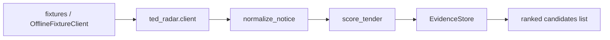

# TED Tender Radar

[](https://github.com/marchikx/ted-tender-radar/actions/workflows/ci.yml) 

Small Python library for **TED notice intake, normalization, and scoring** — extracted and sanitized from a larger procurement-ingestion prototype. Tests run fully offline via fixtures (no live TED API calls in CI).

> **Hire note:** Built as **TED notice intake + scoring for our ops team** — turning EU procurement notices into normalized records, evidence hashes, and ranked candidates without cold-calling buyers.

## What it does

| Module | Role |
|--------|------|
| `ted_radar.client` | Search client protocol + offline fixture / paged mock clients |
| `ted_radar.normalize` | Map TED JSON notices → stable `NormalizedTender` + `sha256` content hash |
| `ted_radar.score` | 0–100 score from CPV fit, title keywords, and budget presence |
| `ted_radar.store` | In-memory `EvidenceStore` (append events, list ranked candidates) |

## Architecture



## Trade-offs

- **Offline fixtures vs live TED API** — CI-stable and fast; production search needs rate limits and credentials (out of scope here).
- **In-memory EvidenceStore** — simple ranked output for demos; Postgres is documented in `docker-compose.yml` but optional for `make verify`.
- **Rule score, not ML** — explainable CPV/keyword/budget weights; less adaptive than learned rankers.

## Quick start

```bash
python -m pip install -e ".[dev]"
make verify
```

Example (offline fixture):

```python
from pathlib import Path
from ted_radar.client import OfflineFixtureClient, TedSearchInput
from ted_radar.normalize import normalize_notice
from ted_radar.score import score_tender
from ted_radar.store import EvidenceStore

client = OfflineFixtureClient(Path("fixtures/sample_ted_notice.json"))
page = client.search(TedSearchInput(query="classification-cpv = 72*"))
store = EvidenceStore()

for notice in page.notices:
    tender = normalize_notice(notice, "2026-07-14T01:00:00.000Z")
    if tender:
        store.append(tender, score_tender(tender))

for row in store.list_candidates(min_score=60):
    print(row.score.total, row.tender.title)
```

## Portfolio highlights

- **Boundary-aware normalization** — competition-only, ISO country mapping, deadline parsing, order-independent content hashing.
- **Explainable scoring** — CPV / keyword / budget breakdown (not a black-box ML demo).
- **Test-first offline CI** — `OfflineFixtureClient` and `PagedFixtureClient` mirror pagination edge cases without network.
- **Optional Postgres** — `docker-compose.yml` documents a future persistence layer; verification does not require Docker.

## Project layout

```
ted_radar/           # library
fixtures/            # synthetic TED-like JSON (no real org PII)
tests/
web/index.html       # static dashboard placeholder
docker-compose.yml   # optional Postgres
```

## Design notes

Scoring weights default to IT/services CPV prefixes (`72*`, `48*`, `30*`), procurement-relevant title keywords, and estimated value tiers. Adjust `score_tender(..., target_cpv_prefixes=..., keywords=...)` for your team's ICP.

Live TED search (`api.ted.europa.eu`) is intentionally **out of scope** for this portfolio repo — add a thin HTTP client implementing `TedSearchClientProtocol` when you have network credentials and rate limits defined.

## License

MIT — see [LICENSE](LICENSE).

## Development

```bash
make verify    # pytest -q
```

GitHub Actions runs the same target on Python 3.11 and 3.12.
